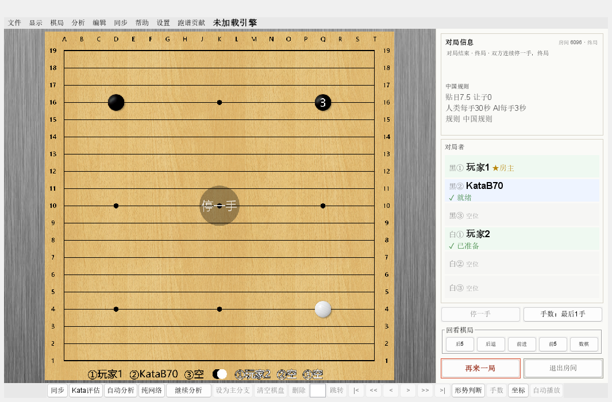
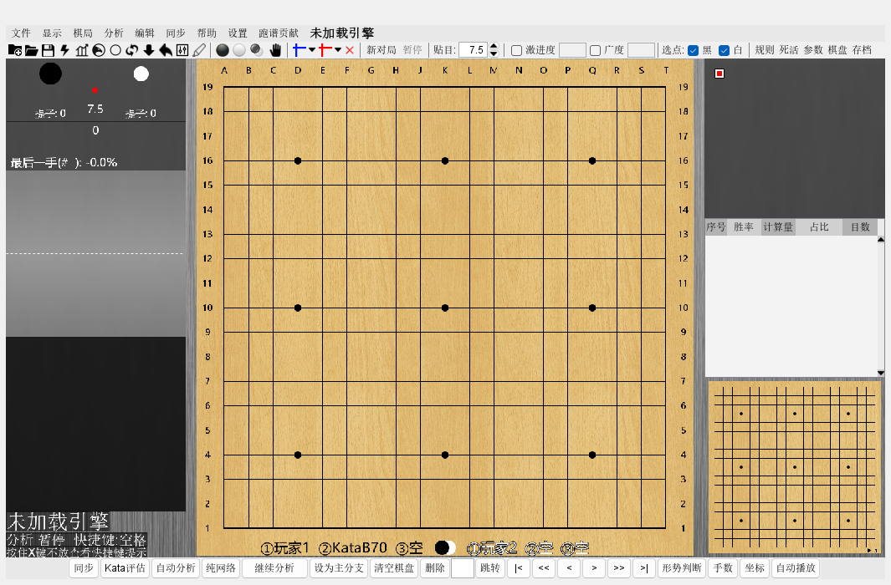

# Lizzie Multiplayer Pair-Go Plugin

A classpath-override plugin for **LizzieYzy 2.5.3** (including the Lizzie bundled with 智子围棋 / Ikatago).
It adds a **3v3 LAN multiplayer room** on top of the original local Pair-Go.

- Version: **3.0.13**
- Base: LizzieYzy **2.5.3** (`lizzie-yzy2.5.3-shaded.jar`)
- Entry: **New Game → Multiplayer (LAN)**; the original local Pair-Go remains on **Alt+L**
- Distribution: `pairgo/lizzie-multiplayer-plugin-3.0.13.zip`

---

## ⬇ Download 3.0.13

| Download | Link |
| --- | --- |
| **Direct zip (recommended)** | [**lizzie-multiplayer-plugin-3.0.13.zip**](https://gitee.com/kindlingycs/lizzie-multiplayer-plugin/raw/master/pairgo/lizzie-multiplayer-plugin-3.0.13.zip) |
| Gitee Release page | [v3.0.13 Release](https://gitee.com/kindlingycs/lizzie-multiplayer-plugin/releases/tag/v3.0.13) |
| Release asset | [Download zip from Release](https://gitee.com/kindlingycs/lizzie-multiplayer-plugin/releases/download/v3.0.13/lizzie-multiplayer-plugin-3.0.13.zip) |
| **GitHub Release asset** | [Download zip from GitHub](https://github.com/kindlingycs-source/YHWQ-automated-game-play/releases/download/lizzie-multiplayer-plugin-v3.0.13/lizzie-multiplayer-plugin-3.0.13.zip) |
| Old 2.1.2 | [lizzie-multiplayer-plugin-2.1.2.zip](https://gitee.com/kindlingycs/lizzie-multiplayer-plugin/raw/master/pairgo/lizzie-multiplayer-plugin-2.1.2.zip) |
| Old 2.0.3 | [lizzie-multiplayer-plugin-2.0.3.zip](https://gitee.com/kindlingycs/lizzie-multiplayer-plugin/raw/master/pairgo/lizzie-multiplayer-plugin-2.0.3.zip) |
| Old 1.0.7 | [lizzie-multiplayer-plugin-1.0.7.zip](https://gitee.com/kindlingycs/lizzie-multiplayer-plugin/raw/master/pairgo/lizzie-multiplayer-plugin-1.0.7.zip) |

> Unzip, then run **安装到智子围棋.bat** (Ikatago/智子) or **启动联棋.bat** (plain Lizzie jar). See “Install” below.

---





---

## Features

- **3v3, six seats** (B1–B3, W1–W3); each seat can be human, AI or empty.
- At least two humans are required; each side needs at least one non-empty seat.
- 4-digit room code `0001–9999`; create or join from the same LAN.
- The host embeds the WebSocket room server; other players connect as clients.
- Host transfer on host exit; room closes only when everybody has left/disconnected.
- The host does not need to ready up; other players ready, host starts.
- Rules: komi, handicap, Chinese/Japanese rules, human seconds 0–180 (0 = no limit),
  AI seconds or playouts, AI resignation thresholds.
- Last rules are reused for a new room; “restore defaults” checkbox in the rules panel.
- No AI analysis during the multiplayer game; SGF is saved automatically on game end.
- Host disconnect box: **wait / skip** only (no “end game” permission); grey for non-hosts.
- **Exit room** button is always available; leaving restores the native Lizzie layout,
  including the bottom toolbar and analysis panels.
- End-of-game: **review controls** (back 5 / back / forward / forward 5) and a **simple
  area score** button.
- The local Pair-Go mode is untouched.

---

## Install

### 智子围棋 (recommended)

1. Unzip `lizzie-multiplayer-plugin-3.0.13.zip`.
2. Close 智子围棋 completely.
3. Run **安装到智子围棋.bat** (backs up `run.bat`, copies the plugin jar).
4. Start 智子围棋 normally.

Uninstall with **卸载（智子）.bat**. Re-run the installer after a 智子 update overwrites `run.bat`.

### Plain Lizzie (jar)

1. Put the `多人联棋插件` folder next to `lizzie-yzy2.5.3-shaded.jar` and `jre`.
2. Run **启动联棋.bat**.

The single-file Lizzie exe cannot load external plugins; use the jar build or the 智子 build.

---

## Usage

1. **New Game → Multiplayer (LAN)**.
2. **Create room** or **Join room**. The host gets a 4-digit code.
3. Host configures rules and seats (human / AI / empty).
4. Other humans press **Ready**; the host presses **Start**.
5. During the game: play, pass, resign, or leave the room at any time.
6. After the game: save SGF, review moves, simple score, rematch, or leave.

The host runs on the LAN only. Allow Lizzie through the firewall; UDP 45231 is used for
room discovery, the WebSocket port is random. Cross-subnet / public-internet play is not
supported in LAN v1.

---

## Build

Requirements: JDK 17 (compiling to Java 8), LizzieYzy 2.5.3 original jar.

```powershell
powershell -NoProfile -ExecutionPolicy Bypass -File build-local.ps1
python pack-plugin.py --log "3.0.13 release"
```

The built jar is `plugin/多人联棋插件/pairgo-plugin.jar`; `pack-plugin.py` creates the
zip, `version.json`, and syncs the desktop copy.

`version.json` contains the **jar MD5**, while `downloadUrl` points to the zip.

---

## Tests

- `MultiAutoTest` — GUI end-to-end: host/AI/joiner, hidden analysis, moves, SGF, review,
  rematch, and native-toolbar restore after exit.
- `MultiReadyRulesTest` — headless rules/ready regression.
- `MultiJoinBot` — headless client that joins, readies, plays random moves and returns to lobby.

3.0.13 GUI test result: `PASS`; `native toolbar restored visible=true height=26`.

---

## Roadmap

- In-game **request scoring** (`SCORING` phase): dead-stone marking by both sides,
  server-side area/territory score, accept/reject, SGF result, AI-side confirmation.
- The current end-game score is Tromp-Taylor area counting on the current board
  (no automatic dead-stone removal).

---

## License

Based on [lizzieyzy](https://github.com/yzyray/lizzieyzy) (GNU GPL v3). Modified sources are
included in the `源码/` folder of the distribution zip.

- Gitee: <https://gitee.com/kindlingycs/lizzie-multiplayer-plugin>
- GitHub mirror: <https://github.com/kindlingycs-source/YHWQ-automated-game-play> (`lizzie-multiplayer-plugin/`)
