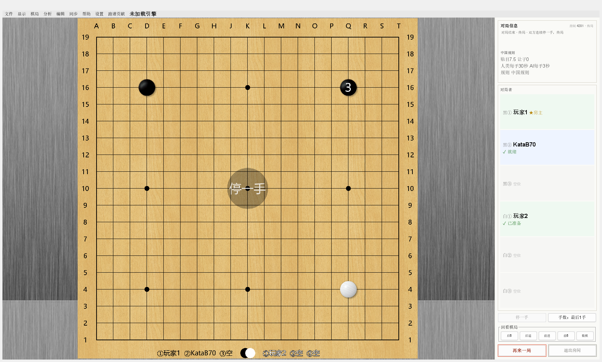
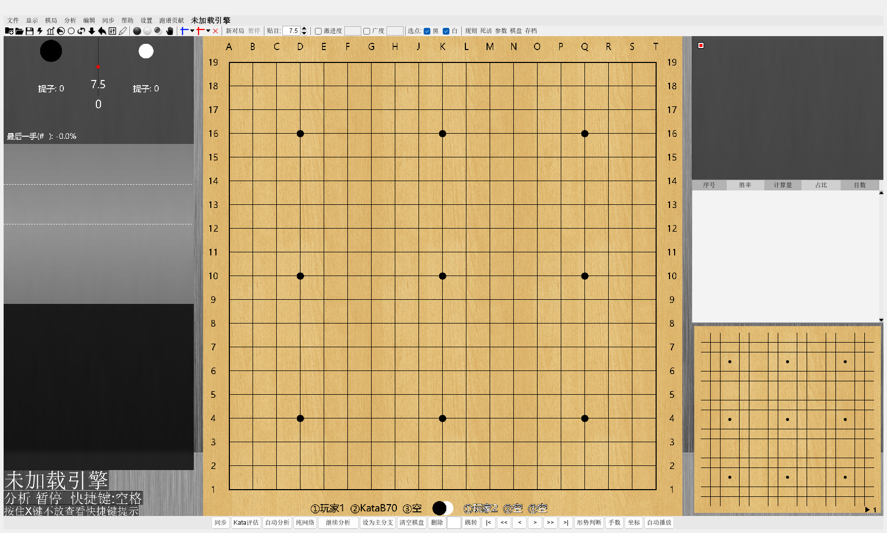

# Lizzie 多人联棋插件 · 多人约战

给 **LizzieYzy 2.5.3**（含智子围棋电脑版内置的 Lizzie）增加「多人约战」局域网联棋功能：
**3v3 六座**，每个座位可以是 **人类 / AI / 空**，支持 1v1、2v2、3v3 及人机混编。

- 当前版本：**3.0.17**
- 支持底座：LizzieYzy **2.5.3**（`lizzie-yzy2.5.3-shaded.jar`，MD5 `19e31482966b7bdb0eb042f45d4fb6e0`）
- 入口：**新对局 → 多人约战（真人联机）**；本地联棋仍然保留原来的 **Alt+L**
- 插件形态：类路径覆盖式插件，只放改动过的类，**不改底座 jar**

---

## ⬇ 下载最新版 3.0.17

| 下载方式 | 链接 |
| --- | --- |
| **直接下载 zip（推荐）** | [**lizzie-multiplayer-plugin-3.0.17.zip**](https://gitee.com/kindlingycs/lizzie-multiplayer-plugin/raw/master/pairgo/lizzie-multiplayer-plugin-3.0.17.zip) |
| Gitee Release 页面 | [v3.0.17 Release](https://gitee.com/kindlingycs/lizzie-multiplayer-plugin/releases/tag/v3.0.17) |
| Release 附件直链 | [从 Release 下载 zip](https://gitee.com/kindlingycs/lizzie-multiplayer-plugin/releases/download/v3.0.17/lizzie-multiplayer-plugin-3.0.17.zip) |
| **GitHub Release 附件** | [从 GitHub 下载 zip](https://github.com/kindlingycs-source/YHWQ-automated-game-play/releases/download/lizzie-multiplayer-plugin-v3.0.17/lizzie-multiplayer-plugin-3.0.17.zip) |
| 旧版 2.1.2 | [lizzie-multiplayer-plugin-2.1.2.zip](https://gitee.com/kindlingycs/lizzie-multiplayer-plugin/raw/master/pairgo/lizzie-multiplayer-plugin-2.1.2.zip) |
| 旧版 2.0.3 | [lizzie-multiplayer-plugin-2.0.3.zip](https://gitee.com/kindlingycs/lizzie-multiplayer-plugin/raw/master/pairgo/lizzie-multiplayer-plugin-2.0.3.zip) |
| 旧版 1.0.7 | [lizzie-multiplayer-plugin-1.0.7.zip](https://gitee.com/kindlingycs/lizzie-multiplayer-plugin/raw/master/pairgo/lizzie-multiplayer-plugin-1.0.7.zip) |

> 下载后解压，运行 **安装到智子围棋.bat**（智子电脑版）或 **启动联棋.bat**（普通 Lizzie jar 版）。
> 完整安装说明见下方「二、安装」。

---





---

## 一、功能概览

### 1. 多人约战（LAN v1）

- **3v3 六座**：黑方 B1/B2/B3、白方 W1/W2/W3，每座可选 **人类 / AI / 空**。
- **至少 2 个真人**才能开局；每方至少 1 个非空座位。
- **4 位房间号** `0001~9999`；同一局域网内保证不重号。
- **开房间 / 进入房间**：开房者自动成为房主，其他人通过房间号加入。
- 房主就是房间服务器：房主 Lizzie 内嵌 WebSocket 服务，其他玩家作为客户端连接。
- 支持 **房主转让**：房主退出时随机转给仍在线的玩家；房间内所有人都离开/掉线才关闭。
- 房主**不需要点准备**；其他玩家准备后房主即可开始。
- 对局中**不显示任何 AI 分析数据**（胜率、变化图、推荐点、分析面板全部隐藏），只保留棋盘和对局信息。
- 每局结束**自动保存 SGF** 到 Lizzie 上次保存棋谱的目录。
- 终局后房间不关闭，可直接 **再来一局**；大厅会显示还在对局页的玩家。

### 2. 规则设置

- 棋盘：19 路；贴目、让子（0 或 2~9）。
- 规则集：中国规则 / 日本规则。
- 人类 **秒/手 0~180**：填 `0` 表示不限时。
- AI **秒/手** 或 **按计算量** 二选一；勾选「按计算量」时 AI 秒/手自动置灰。
- AI 认输条件：胜率阈值 / 连续手数 / 手数下限；可整体关闭。
- 房主每次开房默认复用上一次的规则；规则区右下角有 **恢复默认设置** 勾选框。
- 非法规则输入会在开始前按字段给出明确提示（不会带着错误规则开局）。

### 3. 计时、语音与终局

- 服务端权威计时；轮到自己时右上角显示剩余秒数。
- 本地人类回合最后 10 秒用系统语音读秒，尽量与画面秒数同步。
- 认输：整队判负，但仍停留在对局页，可选择 **再来一局** 或 **退出房间**。
- 双方连续停一手 / 超时 / 整方真人掉线等由服务端终结。
- **退出房间按钮常驻**在「认输」右边；对局中任何玩家都可以直接退出。
- 退出后**恢复原生 Lizzie 界面**：底部工具栏、分析面板、PairGo 状态都恢复；不会把原生界面搞乱。

### 4. 终局回看与数棋

- 终局后「掉线处理」框自动切换为 **回看棋局**：
  - 后 5 手 / 后退 1 手 / 前进 1 手 / 前 5 手
  - **数棋**：按当前盘面做简易面积数子，显示黑白、贴目和胜负
- 当前数子采用 **Tromp-Taylor 面积法**，按当前盘面计算，**不自动提死子**。
  精确数子（标记死子、双方确认）是下一阶段要做的 **对局中申请数子模块**。

### 5. 本地联棋保持不变

- 原来的本地联棋入口 **Alt+L** 和 1v1/2v2/概率联棋逻辑完全保留。
- 多人约战是独立入口，不改变本地联棋的座位、规则和 AI 行为。

---

## 二、安装

### 1. 智子围棋电脑版（推荐）

1. 下载 `pairgo/lizzie-multiplayer-plugin-3.0.17.zip` 并解压；
2. **完全关闭**智子围棋电脑版；
3. 双击 **安装到智子围棋.bat**：
   - 自动找到 `...\ikatago_gui_installer\app-*\resources\data\lizzieyzy`
   - 备份原 `run.bat` 为 `run.bat.bak-pairgo`
   - 复制 `pairgo-plugin.jar`，并把启动参数改成先加载插件
4. 正常打开智子，即可使用。

> 还原：双击 **卸载（智子）.bat**，恢复 `run.bat` 并删除插件 jar。
> 智子升级后可能覆盖 `run.bat`，重新运行一次安装脚本即可。

### 2. 普通 Lizzie（jar 版）

1. 把整个 `多人联棋插件` 文件夹放到 Lizzie 主程序目录（和 `lizzie-yzy2.5.3-shaded.jar`、`jre` 同级）；
2. 双击 **启动联棋.bat**。

> 单文件 exe 版把 jar 打进 exe，外部插件挂不上；请用 jar 版或智子内置 Lizzie。

### 3. 兼容性

- 已验证：LizzieYzy **2.5.3** 原版 jar。
- 其他 2.0~2.5 版本可尝试，但插件按 2.5.3 编译，缺少新 API 时可能报错；请先备份。
- 需要 Java 17（智子自带 JRE 可直接用）。

---

## 三、使用

### 开房 / 进房

1. 主界面菜单 **新对局 → 多人约战（真人联机）**；
2. 选择 **开房间** 或 **进入房间**；
3. 开房后得到 4 位房间号；同一局域网的玩家输入房间号加入；
4. 房主设置规则、给空位选择人类 / AI / 空；
5. 其他真人点 **准备**；房主点 **开始对局**。

> 房主自己不用准备。
> 进入房间时如果无法自动发现，可手动填主机 IP 和端口。

### 座位

- **人类**：本人操作；可设置本局人类秒/手（0 = 不限时）。
- **AI**：由添加它的玩家提供引擎，引擎跑在该玩家的 Lizzie 里；添加时自动自检。
- **空**：该座位无人。

### 对局中

- 轮到自己时落子；自己的回合可以 **停一手** 或 **认输**。
- **退出房间** 常驻，对局中也可以直接退出；退出会关闭多人对弈界面并恢复原生 Lizzie。
- 房主掉线处理框只有 **跳过 / 等待**，没有「结束对局」权限。
- 非房主看到的掉线处理框是灰的，不能操作。

### 终局

- 终局后：
  - 自动保存 SGF；
  - 「掉线处理」框变为 **回看棋局**（后5/后退/前进/前5/数棋）；
  - 「认输」按钮变为 **再来一局**；
  - 「退出房间」仍然常驻。
- 点 **再来一局** 回到大厅；其他玩家会看到「对局中」，从对局页返回后即可准备下一局。

---

## 四、对局中的申请数子（下一阶段）

当前 3.0.17 只有 **终局后回看** 里的简易数子。对局中「申请数子」模块计划如下：

1. 任意一方点 **申请数子**；
2. 房间进入 `SCORING` 暂停阶段，双方看到当前盘面；
3. 双方可以 **标记死子**（点击棋子切换死活），盘面实时重算归属；
4. 双方确认后，服务端按中国/日本规则和贴目算出最终结果，对局结束并写入 SGF；
5. 任一方拒绝则恢复对局；
6. AI 座位由该方真人代理确认；如果一方全是 AI，则按预设策略自动确认或拒绝。

这一块会单独做成可测试的 **数子协议 + 死子标记 UI + 面积/数目计分**，再接进 `SCORING` 阶段。

---

## 五、网络与架构

```
房主 Lizzie
  ├─ WebSocketServer（随机端口，局域网监听）
  ├─ MultiDiscovery（UDP 45231，房间号发现）
  ├─ 房主客户端（playerId=1，房主/权威状态）
  └─ 其他 Lizzie（WebSocketClient，通过房间号加入）

服务端只维护房间状态、座位、规则、轮次、计时和落子记录；
不实现围棋规则，也不做 AI 分析。
```

- 房主是唯一权威：落子、计时、终局、房间状态由房主端服务端广播。
- 玩家退出/掉线：服务端标记离线；对局中进入暂停，由房主选择等待/跳过。
- 房主退出：房间不关闭，自动转让房主；所有玩家离开/掉线才关闭。
- **房主关闭整个 Lizzie 程序**时房间服务随进程结束；这是 LAN v1 的已知限制。
- 局域网发现端口：**UDP 45231**；WebSocket 端口随机。
- 防火墙需要允许 Lizzie 的局域网入站；不同网段/跨公网暂不支持。

---

## 六、构建

环境：

- JDK 17（编译目标 Java 8）
- LizzieYzy 2.5.3 原版 jar：`lizzie-yzy2.5.3-shaded.jar.orig`
- 源码：`source/src/main/java/...`

构建：

```powershell
# Windows
powershell -NoProfile -ExecutionPolicy Bypass -File build-local.ps1

# Linux/macOS
bash build-local.sh
```

输出：

- `plugin/多人联棋插件/pairgo-plugin.jar`
- `plugin/多人联棋插件/plugin-version.txt`
- `plugin/多人联棋插件/使用说明.md`

打包分发：

```bash
python pack-plugin.py --log "3.0.17：多人约战 3v3、合并对局信息/规则、回看棋局、简易数子、退出后原生界面恢复"
```

输出：

- `plugin/多人联棋插件-v3.0.17.zip`
- `plugin/lizzie-multiplayer-plugin-3.0.17.zip`
- `plugin/version.json`
- 同时同步桌面 `多人联棋插件` 文件夹

`version.json` 中 `md5` 是 **pairgo-plugin.jar 的 MD5**；`downloadUrl` 指向 zip。

---

## 七、测试

### 1. GUI 自测 `MultiAutoTest`

```powershell
java -Dmulti.autotest=1 `
     -Dmulti.autotest.out=build/multi-autotest.out `
     -Dmulti.autotest.shot=build/multi-postgame.png `
     -cp "build/classes;lizzie-yzy2.5.3-shaded.jar.orig" `
     featurecat.lizzie.Lizzie
```

覆盖：开房、AI 座位、加入、准备、开局、隐藏分析面板、AI 落子、终局、SGF、回看、再来一局、退出后原生工具栏恢复。

3.0.17 实测：

- `PASS`
- 终局面板三块：对局信息+规则合并 178px / 对局者 312px / 按钮 125px
- 退出后：`native toolbar restored visible=true height=26`
- SGF 自动保存成功

### 2. 无界面规则回归 `MultiReadyRulesTest`

覆盖：房主免准备、`humanSec=0` 不限时且无超时、规则复用、开始参数校验。

### 3. 联机陪练 `MultiJoinBot`

无界面加入房间、自动准备、随机落子；终局后延迟 5 秒返回大厅，方便测试「对局中」和再来一局。

---

## 八、目录结构

```
source/src/main/java/featurecat/lizzie/
  multi/
    MultiRoomServer.java      房主端 WebSocket + 房间服务
    MultiRoomClient.java      客户端连接/消息
    MultiGame.java            对局页与棋盘同步
    MultiSeatBar.java         右侧对局信息/操作面板
    MultiRoomDialog.java      开房/进房/规则弹窗
    MultiDiscovery.java       UDP 45231 房间发现
    RoomState.java            房间/座位/规则状态
    RoomRules.java            规则与上次规则持久化
    MultiEngine.java          AI 座位引擎
    Score.java                简易面积数子
    ...
  gui/
    LizzieFrame.java          入口、布局恢复、原生工具栏恢复
    BottomToolbar.java        对局中原生按钮锁定
  ...
plugin/多人联棋插件/
  pairgo-plugin.jar
  安装到智子围棋.bat
  卸载（智子）.bat
  启动联棋.bat
  使用说明.md
  源码/
tests/
  MultiAutoTest.java
  MultiReadyRulesTest.java
  MultiHostBot.java
  MultiJoinBot.java
```

---

## 九、版本历史

| 版本 | 内容 |
| --- | --- |
| 3.0.17 | 合并对局信息+规则；终局回看棋局；简易数子；退出后原生底部工具栏恢复 |
| 3.0.11 | 规则格式调整；AI 秒/手按计算量置灰；恢复默认设置；退出按钮常驻 |
| 3.0.10 | 完整规则显示、房主掉线处理一行、非房主灰框、语音读秒同步 |
| 3.0.9 | 房主免准备、人类 0 秒不限时、规则复用与校验 |
| 3.0.8 | 3v3 六座、LAN 开房/进房、AI 座位、断线等待/跳过 |
| 2.1.x | 本地联棋：概率联棋、手数显示、单座固定 100% |
| 2.0.x | 人类限时、AI 时间/计算量、认输条件 |
| 1.0.x | 本地联棋初版 |

---

## 十、已知限制

- LAN v1 只支持同一局域网；跨公网/跨网段暂不支持。
- 房主关闭整个 Lizzie 进程会关闭房间服务；退出房间会正常转让房主。
- 当前数子按盘面面积计算，不自动提死子；对局中申请数子+死子标记在下一阶段。
- 单文件 exe 版 Lizzie 无法挂载外部插件。
- AI 座位需要该玩家自己配置引擎；正在分析的那台引擎不能当 AI 座位。
- 底座非 2.5.3 时可能需要重新编译。

---

## 十一、许可与来源

本插件基于开源项目 [lizzieyzy](https://github.com/yzyray/lizzieyzy)（GNU GPL v3）修改，
只替换联棋相关的类。按 GPL 要求，修改后的源码随包提供在 `源码/` 目录。

- Gitee：<https://gitee.com/kindlingycs/lizzie-multiplayer-plugin>
- GitHub 镜像：<https://github.com/kindlingycs-source/YHWQ-automated-game-play>（`lizzie-multiplayer-plugin/` 子目录）
- 问题反馈：请在仓库 Issues 留言，附版本号、底座版本和复现步骤。
